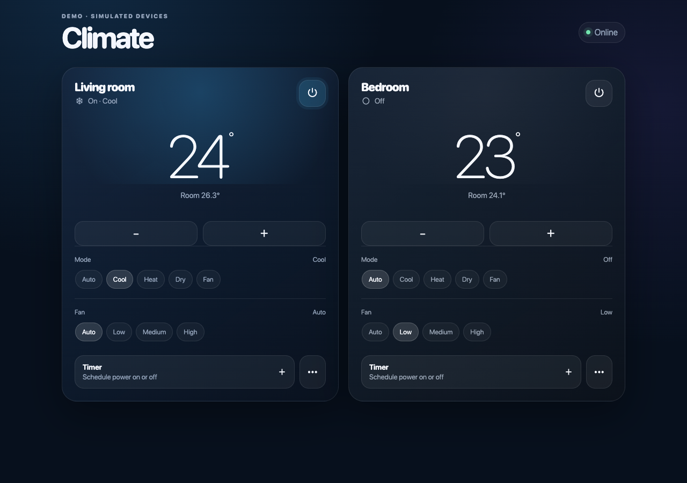
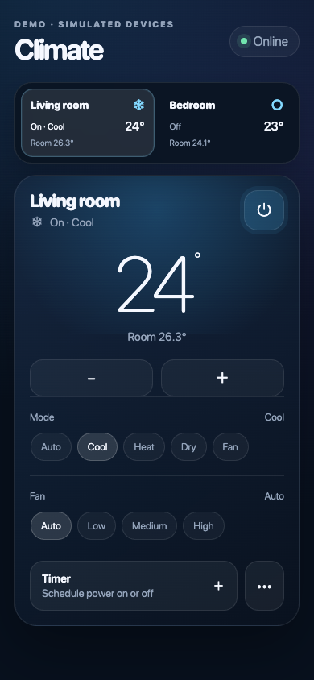

<p align="center">
  
</p>

<h1 align="center">Haier Control</h1>
<p align="center"><strong>Your home's climate, at a glance.</strong><br>
An independent, self-hosted dashboard for Haier hOn air conditioners.</p>

<p align="center">
  <a href="https://github.com/tofusito/haier-control/actions/workflows/ci.yml"></a>
  <a href="LICENSE"></a>
  <a href="pyproject.toml"></a>
</p>

<p align="center">
  <a href="#try-the-demo">Try the demo</a> ·
  <a href="docs/product-overview.md">Product overview</a> ·
  <a href="docs/README.md">Documentation</a> ·
  <a href="CONTRIBUTING.md">Contribute</a>
</p>



*Actual application, using simulated devices. All interface text is in English.*

## Why it exists

I built Haier Control as a Haier customer who wanted a focused interface for everyday
air-conditioning tasks: see the temperature, adjust a setting and schedule a timer.
The project explores how a small, responsive web dashboard can make those tasks clearer.

This is a working independent prototype, offered as a starting point for user feedback
and product discussion. It is not an official Haier application.

## Designed for everyday control

| | |
| --- | --- |
| **A clear view of every room** | Target and room temperatures, power and mode at a glance. A compact selector on mobile; side-by-side cards on desktop. |
| **Controls that fit the appliance** | Modes, fan speeds, swing and advanced options follow the capabilities the device reports. |
| **Immediate, honest feedback** | Controls respond immediately while a request is pending. Rejected or timed-out requests roll back and show a retry message. |
| **Timers that live on your server** | Schedule power on or off by duration or date/time. Edit or cancel timers without erasing their history. |
| **An integration-friendly core** | A versioned API, scoped access tokens, local SSE updates and interchangeable device drivers. |

<details>
<summary>Mobile preview</summary>
<p align="center"></p>
</details>

## Try the demo

No appliance account or Docker installation is needed. From a fresh checkout:

```sh
git clone https://github.com/tofusito/haier-control.git
cd haier-control
python3 -m venv .venv
. .venv/bin/activate
pip install -e .
python -m scripts.demo
```

Requires Python 3.12 or newer. Open **http://127.0.0.1:8788**.

The demo always uses simulated devices, binds to loopback and creates temporary runtime
data. It cannot send commands to real appliances. Demo state resets when you stop it.
To use a different local port, run `python -m scripts.demo --port 8789`.

See the [five-minute walkthrough](docs/demo.md) for a suggested evaluation sequence.

## Run with Docker

The default Compose service also uses simulated devices. For a **new installation**:

```sh
mkdir -p data secrets
chmod 700 data secrets
python3 -c 'import os, secrets; f = os.open("secrets/master_key", os.O_WRONLY | os.O_CREAT | os.O_EXCL, 0o600); os.write(f, secrets.token_urlsafe(48).encode()); os.close(f)'
docker compose up --build -d
docker compose exec haier-control haier-control token --name browser
```

Open **http://127.0.0.1:8787** and paste the generated API token. The key command refuses
to overwrite an existing master key. Keep that key for every subsequent update.

For real appliances, select `HAIER_DRIVER=haier-cloud` and follow the
[hOn setup guide](docs/configuration.md#connecting-to-hon). hOn remains necessary for live
state and control; hosting the dashboard locally does not make the appliances work offline.

## How it fits together

```text
Browser / integrations
          |
    Local API + SSE
          |
  Controller ── Scheduler ── SQLite
          |
     Driver contract
       /         \
 MockDriver    HaierCloudDriver ── hOn cloud ── Air conditioners
```

The dashboard, API, scheduler and persistence run on your host. The cloud driver handles
authentication, discovery, state reads and commands. Home Assistant is not required.

## Current scope

- **Implemented:** mock and cloud drivers, mobile and desktop UI, timers, encrypted
  session recovery, local authentication and capability-aware controls.
- **Limited compatibility:** settings-based AC command schemas are supported.
  Program-based command families and broad model coverage remain future work.
- **State updates:** hOn state is read over REST when requested. Local SSE announces
  changes processed by this app; it is not a vendor realtime feed. Physical-remote
  changes may require a manual refresh. Continuous background polling and MQTT are
  not implemented.
- **Validation boundary:** automated checks exercise mock devices and redacted cloud
  fixtures. They do not certify appliance behavior across models or run physical commands.
- **Deployment:** intended for a private LAN or tailnet, with explicit authentication.

The hOn API is private and unofficial. It may change without notice. See
[compatibility](docs/compatibility.md), the [security model](docs/security.md) and
[roadmap](ROADMAP.md) for the remaining work.

## Documentation and contribution

Start with the [documentation index](docs/README.md) or [CONTRIBUTING.md](CONTRIBUTING.md).
The repository includes architecture, configuration, deployment, troubleshooting,
protocol provenance and a [changelog](CHANGELOG.md).

Security concerns should be reported through the channels in [SECURITY.md](SECURITY.md).

## License and independence

[MIT licensed](LICENSE). Haier Control independently implements interoperability facts
documented in the public addhOn protocol specification; it contains no copied addhOn code.
See the [protocol notes](docs/haier-protocol.md) for attribution and scope.

Haier and hOn are trademarks of their respective owners. This project is not affiliated
with or endorsed by Haier. Contributors follow the [Code of Conduct](CODE_OF_CONDUCT.md).
